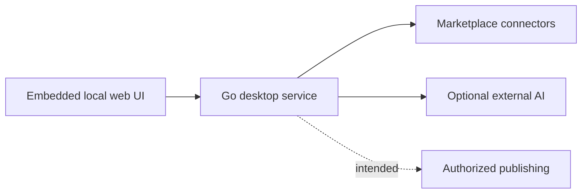

# LinkPilot — engineering quality / engenharia
Creator and owner: João Victor da Silva (JustJao1).
EN: Experimental Windows affiliate-offer workflow tool; intended product selection, message drafting and authorized publishing.
PT: Ferramenta experimental Windows para pesquisa de ofertas, elaboração de mensagens e publicação autorizada.

This architecture is based on the repository README, not an audit of the original source.
ADR-001 (recommended): Keep OAuth tokens local and out of logs. ADR-002: Separate offer discovery from publication; validate links and require explicit authorization. ADR-003: Do not promise unattended operation until end-to-end verification.
## Technical demo (EN)
Describe marketplace setup, non-food filtering, attribution checks and error diagnostics. Show a non-production example only if the executable is available. Do not send messages or authenticate third-party accounts during review.
## Demonstração (PT)
Explique configuração de lojas, filtro de produtos, validação de links e diagnósticos. Use exemplo sem produção; não publique mensagens nem acesse contas.
## Verification
The public repository currently does not include the original Go code or executable. No new tests, coverage, Docker build or production integrations can be verified here. Historical test results remain attributed to the original documentation.
## AI-assisted review
Once code is available, review OAuth scopes, secrets, data handling, API terms, publication consent, rate limits, and automated tests. Do not assert this has already been done.
